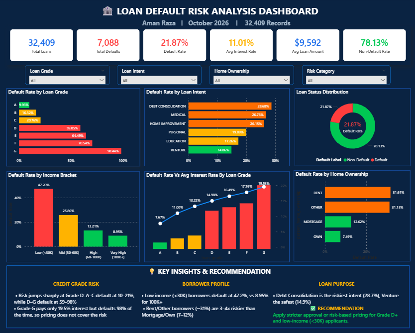

# 🏦 Loan Default Risk Analysis | SQL, Python & Power BI

An end-to-end **Loan Default Risk Analysis** project using SQL, Python, and Microsoft Power BI to analyze borrower behavior, identify high-risk loan segments, and understand patterns associated with loan defaults.

The project transforms raw loan data into meaningful insights through data analysis, KPI development, and interactive visualizations.

---

## 📊 Dashboard Preview



---

## 🎯 Project Objectives

- Analyze overall loan default and non-default rates.
- Identify high-risk loan grades.
- Understand loan default patterns across different loan purposes.
- Analyze the relationship between borrower income and loan defaults.
- Evaluate default rates across home ownership categories.
- Compare average interest rates with default rates.
- Generate business recommendations based on analytical findings.

## 🛠️ Tools & Technologies

| Technology | Purpose |
|---|---|
| MySQL | Data querying and analysis |
| Python | Data analysis and processing |
| Pandas | Data manipulation |
| NumPy | Numerical operations |
| Matplotlib / Seaborn | Data visualization |
| Microsoft Power BI | Interactive dashboard |
| DAX | KPI calculations |
| Power Query | Data transformation |

## 📌 Key Performance Indicators (KPIs)

| KPI | Value |
|---|---:|
| Total Loans | 32,409 |
| Total Defaults | 7,088 |
| Default Rate | 21.87% |
| Non-Default Rate | 78.13% |
| Average Interest Rate | 11.01% |
| Average Loan Amount | $9,592 |

*Note: These are the values displayed in the current Power BI dashboard. Verify them against the final source data before publishing.*

---

## 📈 Dashboard Analysis

The Power BI dashboard includes six major visualizations:

### 1. Default Rate by Loan Grade
Analyzes default rates across loan grades A to G to identify high-risk credit segments.

### 2. Default Rate by Loan Intent
Compares default rates across different loan purposes, including:
- Debt Consolidation
- Medical
- Home Improvement
- Personal
- Education
- Venture

### 3. Loan Status Distribution
Displays the proportion of default and non-default loans.

### 4. Default Rate by Income Bracket
Examines the relationship between borrower income levels and loan defaults.

### 5. Default Rate vs Average Interest Rate
Compares default rates and average interest rates across different loan grades.

### 6. Default Rate by Home Ownership
Evaluates default patterns among borrowers with different home ownership statuses.

---

## 🔍 Key Business Insights

### 1. Credit Grade Analysis
- Grade G has the highest displayed default rate of approximately 98.44%.
- Grade A has the lowest displayed default rate of approximately 9.96%.
- Lower loan grades show substantially higher default rates.

### 2. Income Analysis
- Low-income borrowers (below $30K) show a 47.20% default rate.
- Very high-income borrowers ($100K+) show an 8.95% default rate.

### 3. Loan Intent Analysis
- Debt Consolidation has the highest displayed default rate at 28.68%.
- Venture loans have the lowest displayed default rate at 14.86%.

### 4. Home Ownership Analysis
- RENT borrowers show a 31.61% default rate.
- OTHER borrowers show a 31.13% default rate.
- OWN borrowers show a 7.49% default rate.

---

## 💡 Business Recommendations

Based on the analysis:

- Apply enhanced risk assessment to borrowers in higher-risk loan grades.
- Carefully evaluate repayment capacity among lower-income applicants.
- Strengthen underwriting checks for debt consolidation loans.
- Consider credit grade, income, loan purpose, and interest rate together when evaluating lending risk.
- Monitor default patterns regularly to support better lending decisions.

*These recommendations are based on descriptive analysis and do not represent a validated credit scoring or loan approval model.*

---

## 🗄️ SQL Analysis

The SQL analysis covers:

- Data verification and exploration
- Aggregate functions: COUNT, SUM, AVG
- GROUP BY and ORDER BY
- CASE WHEN statements
- Default rate calculations
- Subqueries
- Common Table Expressions (CTEs)
- Window Functions:
  - RANK()
  - DENSE_RANK()
  - ROW_NUMBER()
- HAVING clause
- Business risk segmentation

## 🐍 Python Analysis

Python is included in the project for data analysis and processing.

Libraries used (where applicable):
- Pandas
- NumPy
- Matplotlib
- Seaborn

See the `Python` folder for the analysis notebook or script.

## 🎛️ Interactive Dashboard Features

The dashboard includes interactive slicers for:

- Loan Grade
- Loan Intent
- Home Ownership
- Risk Category

Users can explore loan default patterns across different borrower segments.

---

## 📂 Repository Structure

```text
Loan-Default-Risk-Analysis/
│
├── README.md
│
├── Dataset/
│
├── SQL/
│   └── loan_default_analysis.sql
│
├── Python/
│   └── loan_default_analysis.ipynb
│
├── Dashboard/
│   └── Loan_Default_Risk_Analysis.pbix
│
└── Images/
    └── loan-default-dashboard.png
```

## 🚀 Project Outcome

This project demonstrates practical skills in:

- SQL-based data analysis
- Python and Pandas
- Data cleaning and processing
- Power BI dashboard development
- DAX and KPI calculations
- Business insights and data storytelling
- Loan default risk analysis

---

## 👨‍💻 About Me

**Aman Raza**

Aspiring Data Analyst | M.Sc. Mathematics

**Technical Skills:** SQL | Python | Pandas | Power BI | Excel

- GitHub: [amanraza9955]
- (https://github.com/amanraza9955)
- LinkedIn: [Aman Raza]
- (https://linkedin.com/in/aman-raza-ds)

---

⭐ If you find this project useful, feel free to explore the repository and share your feedback.
